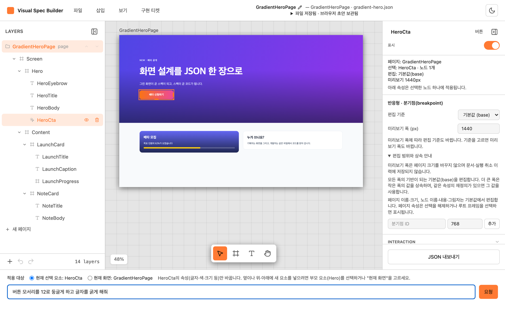
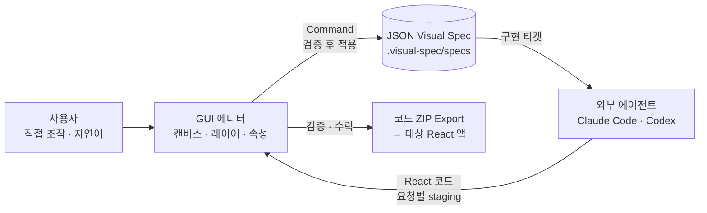
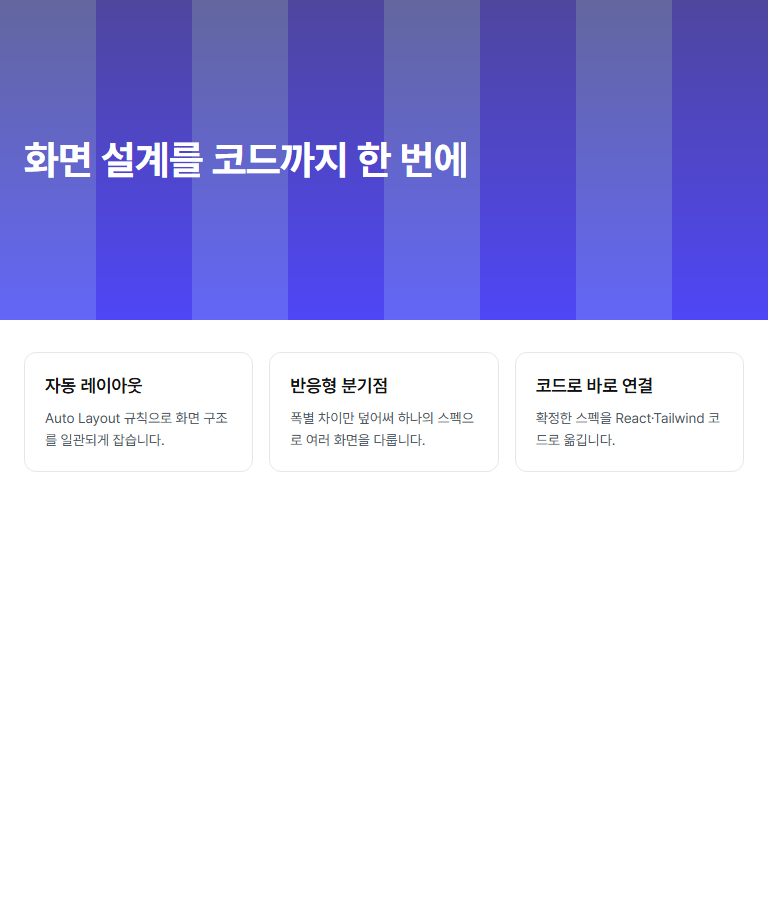

# Visual Spec Builder

**화면을 그리면 JSON 스펙이 되고, AI 에이전트가 그 스펙을 React 코드로 구현한다.**

Visual Spec Builder는 내 컴퓨터(localhost)에서 실행하는 화면 설계 GUI 도구다.
사용자는 캔버스에서 직접 조작하거나 자연어로 요청해 화면을 만들고, 도구는 결과를 JSON Visual Spec으로 저장한다.
옆에 띄워 둔 Claude Code나 Codex가 그 스펙을 읽어 실제 React 코드를 만들고, GUI는 만들어진 코드를 검증한 뒤 ZIP으로 내보낸다.



## 왜 만들었나

AI에게 "로그인 화면 만들어 줘"라고 하면 코드는 바로 나오지만, 화면 구조를 먼저 보고 고칠 기회가 없다.
결과가 마음에 들지 않으면 코드 단위로 다시 설명해야 하고, 같은 요청도 실행할 때마다 다른 구조가 나온다.

Visual Spec Builder는 그 사이에 **눈으로 확인하고 고칠 수 있는 화면 스펙**을 둔다.

- **화면 생성과 코드 생성을 나눈다.** 자연어 요청은 캔버스만 바꾼다. 코드는 사용자가 화면을 확인한 뒤 따로 만든다.
- **GUI와 자연어가 같은 데이터를 만진다.** 버튼을 직접 옮기든 자연어로 옮기든 같은 편집 명령(Command)이 실행되고, 요청 하나는 Undo 한 번으로 되돌아간다.
- **앱은 API 키를 갖지 않는다.** GUI는 AI 모델을 직접 부르지 않고, 사용자가 실행한 에이전트와 작업공간의 파일로 요청과 응답을 주고받는다.
- **기존 프로젝트를 건드리지 않는다.** 전용 작업공간(`.visual-spec/`)에서 화면을 만들고, 완성된 코드만 내보낸다.

설계 근거는 [01. 제품 개요](docs/01-overview.md)와 [08. 자연어 설계](docs/08-natural-language.md)에 있다.

## 어떻게 동작하나



1. `visual-spec init`으로 작업공간을 만들고 `visual-spec skills`로 에이전트용 스킬을 설치한다.
2. `visual-spec`으로 GUI를 띄워 화면을 만든다. 자연어 요청은 에이전트가 Command 배열로 답하고, GUI가 검증한 뒤 적용한다.
3. **구현 티켓**을 실행하면 GUI가 화면을 컴포넌트 단위 티켓으로 나눠 에이전트에 넘긴다. 에이전트는 의존성 순서(웨이브)대로 코드를 만든다.
4. GUI가 각 웨이브의 출력을 검증하고 수락한 뒤, 코드 ZIP으로 내보낸다.

## 주요 기능

| 기능 | 내용 |
|---|---|
| 직접 편집 | 노드 5종(frame·text·image·button·input), Auto Layout·Grid, 다중 배경(단색·그라디언트·이미지), 그림자·테두리, 그룹화, Undo/Redo, 단축키 |
| 자연어 편집 | 선택한 요소나 현재 화면을 말로 고친다. 바뀌는 배경은 적용 전에 확인하고, 에이전트 대화에서 고친 내용도 열린 GUI에 바로 반영된다 |
| 반응형 | 분기점(breakpoint)별 재정의와 폭별 미리보기 |
| 여러 화면 | 화면 종류(page·modal·widget), 버튼으로 화면 이동·모달 열기, 여러 화면이 같은 원본을 쓰는 공유 위젯 |
| 디자인 스타일 | 프로젝트 공용 색·글자 스타일, 버튼·입력의 hover·focus 등 상태 스타일 |
| 구현 티켓 | 화면을 컴포넌트 티켓으로 나누고, 에이전트 출력을 웨이브마다 검증·수락한다. 수동으로 고친 생성 파일은 덮어쓰기 전에 확인한다 |
| 코드 Export | 수락된 화면이나 프로젝트 전체를 ZIP으로 내보내고, 파일·참조·입력 지문을 다시 검사한다 |
| CLI | `init`·`skills`·`validate`와 GUI 실행. 작업공간 저장·복원, 홈 화면의 프로젝트 목록 |

기능별 현재 범위와 경계는 [07. 구현 현황](docs/07-implementation-status.md)에 있다.

## 실제로 만들어 본 결과

실제 AI 모델로 화면을 만들고, 생성된 코드를 **고치지 않은 채** 별도 React 앱에 넣어 빌드·실행했다.

| 날짜 | 에이전트 | 한 일 | 결과 |
|---|---|---|---|
| 2026-10-10 | Claude Code (`claude-opus-5-5`) | 자연어로 로그인·랜딩(반응형) 화면 생성 → GUI 수정 → 코드 생성·재생성 → Export | 두 화면 각 4티켓 완료, 독립 앱 `tsc`·`vite build` 통과, 360·768·1440px 표시 확인 ([28](docs/28-real-flow-regression.md)) |
| 2026-10-17 | Codex CLI | 로그인·대시보드·모달과 공유 위젯으로 된 프로젝트의 코드 생성 | 14/14 티켓, 4웨이브 수락, 프로젝트 ZIP을 독립 앱에서 빌드하고 화면 이동·모달·공유 위젯 동작 확인 ([15](docs/15-workflow-qa.md)) |

<p>
  
  
</p>

각 기록은 그 날짜·커밋·환경의 한 번 실행이며, 임의의 화면에 대한 생성 코드의 빌드나 시각 일치를 보장하지는 않는다.

## 품질 관리

- **단위 테스트**: Vitest로 스키마·Command·스토어·자연어·티켓·Export·CLI를 검사한다.
- **실제 브라우저 여정**: Playwright로 GUI를 띄워 저장·문서 전환·티켓 실행·Export·자연어 같은 사용자 흐름을 fixture 응답으로 끝까지 돌린다.
- **CI**: PR마다 Linux(Node 20·22·24), Windows, Chromium 여정, 레이아웃 실측 7개 작업을 돌리고, 리뷰 승인과 함께 통과를 확인한 뒤 develop에 머지한다.
- **실사용 테스트**: 처음 쓰는 사람이 문서와 화면만 보고 끝까지 진행하는 테스트를 두 차례 진행하고, 나온 문제를 이슈로 고쳤다.

fixture 검증과 실제 모델 검증은 [28. 실제 사용자 흐름 회귀](docs/28-real-flow-regression.md)에서 구분한다.

## 시작하기

Node `^20.19.0 || >=22.12.0`, pnpm 10.33.0이 필요하다.

```bash
git clone --branch develop https://github.com/visual-spec-labs/Visual-Spec-Builder.git
cd Visual-Spec-Builder
corepack pnpm install --frozen-lockfile
VSB_REPO="$(pwd)"

mkdir ../visual-spec-demo && cd ../visual-spec-demo
node "$VSB_REPO/bin/visual-spec.mjs" init
node "$VSB_REPO/bin/visual-spec.mjs" skills
cp "$VSB_REPO/examples/login-screen.json" .visual-spec/specs/login-screen.json
node "$VSB_REPO/bin/visual-spec.mjs"
```

터미널에 나온 주소를 브라우저로 열면 홈 화면에 로그인 예제가 보인다. 자연어 편집, 코드 생성, Export, Windows PowerShell 절차는
[14. 처음부터 따라 하기](docs/14-getting-started.md)를 따른다. 패키지는 `private: true`라 레지스트리에 공개하지 않으며, `pnpm pack`으로 만든 로컬 tarball 설치를 지원한다.

## 기술 스택

| 영역 | 사용 |
|---|---|
| GUI | React 19, TypeScript, Zustand, Tailwind CSS v4, Vite |
| 스키마·검증 | JSON Schema(Ajv), 스키마에서 생성한 TypeScript 타입 |
| CLI·작업공간 | Node.js, Vite 개발 서버 미들웨어 |
| 에이전트 연동 | Claude Code·Codex 스킬, 작업공간 파일 프로토콜 |
| 테스트·CI | Vitest, Playwright, GitHub Actions |

## 팀

다섯 명이 2026년 7월 24일 첫 회의부터 함께 만들었다. 2026-11-06 기준 GitHub에서 PR 283개를 머지했다.

| GitHub | 이름 | 주 영역 |
|---|---|---|
| [Yumesa2025](https://github.com/Yumesa2025) | 김태환 | 기획·통합, 스키마 v0.1, 문서·CI·기여 규칙, GUI와 작업공간 연결, 배경 채우기·반응형·이미지 배경 |
| [GAMMJ](https://github.com/GAMMJ) | 김민재 | 공유 스토어, 캔버스, 속성 패널, 스키마 v0.2, 반응형 설계, 설치 가능한 런타임 |
| [wook3964](https://github.com/wook3964) | 박용욱 | React 코드 생성 스킬, Command Engine과 Undo, Ticket 스키마, CLI, 자연어 생성 |
| [dogui1018](https://github.com/dogui1018) | 김도국 | 메뉴바와 File 메뉴, 레이어 트리, 단축키, 검증 관문(G2·G3), 티켓 실행 왕복, 홈 자연어 초안 |
| [SunMyunC](https://github.com/SunMyunC) | 정선영 | 디자인 토큰과 테마, 피그마식 UI 골격, 하단 도구 모음, GUI 회의 정리 |

단계별 제작 과정은 [제작 연대기](docs/history/README.md)와 [마무리 기록](docs/history/completion.md)에 있다.

---

아래는 저장소에서 작업하는 팀원을 위한 안내다.

## 문서

전체 문서의 목록과 역할은 [문서 안내](docs/README.md)에 있다. 처음 사용한다면 [14. 처음부터 따라 하기](docs/14-getting-started.md),
현재 제공 범위와 남은 검증은 [07. 구현 현황](docs/07-implementation-status.md)을 먼저 읽는다. 설계·동결·QA 문서에는
작성 당시의 제안과 단계별 기록도 있으므로, 날짜·기준 커밋·현재 상태 안내를 함께 확인한다.
설계 논의 기록은 [`docs/superpowers/specs/`](docs/superpowers/specs/)에 있다.

## 디렉터리 구조

```
bin/visual-spec.mjs              init·skills·GUI 실행 CLI
src/app/App.tsx                  홈/에디터 전환과 자동저장 연결
src/features/editor/schema/     스키마 정본·생성 타입·검증기·공개 index
src/features/editor/store/      프로젝트·페이지·선택·history·지속성
src/features/editor/command/    편집 명령 적용·외부 입력 검증
src/features/editor/ui/         홈·캔버스·트리·속성·자연어·티켓·Export UI
src/features/editor/nl/         자연어 요청·응답 파일 프로토콜
src/features/editor/ticket/     티켓 컴파일·상태·요청·응답
src/features/editor/export/     생성 코드·참조 검사와 ZIP 구성
src/features/workspace/         개발 서버 작업공간 파일 API
skills/                         외부 에이전트용 배포 스킬
docs/                           사용법·설계·계약·검증 기록
scripts/generate-types.mjs       스키마 → types.ts 생성
examples/                       유효/무효 예시
test/                           스키마·스토어·명령·CLI·렌더 판단기 등 테스트
```

스키마가 지원하는 범위와 변경 규칙의 전문은 **[`docs/06-schema-freeze.md`](docs/06-schema-freeze.md)** 에 있다.
스키마를 건드리기 전에 반드시 읽는다.

## 팀원이 알아야 할 것

타입은 아래 한 경로에서만 가져온다.

```ts
import type {
  VisualSpec,
  ScreenSpec,
  Node,
  FrameNode,
  TextNode,
} from "@/features/editor/schema";

import { validateVisualSpec } from "@/features/editor/schema";
```

`src/features/editor/schema/` 안의 개별 파일(`types.ts`, `validate.ts`, `visual-spec.schema.json`)을
직접 import하지 않는다. 항상 디렉터리 index를 거친다.

`types.ts`는 `visual-spec.schema.json`에서 생성한 파일이다. 손으로 고치지 않는다.

## 개발

Node `^20.19.0 || >=22.12.0`, pnpm 10.33.0을 사용한다 (`packageManager: pnpm@10.33.0`). Vite 런타임이 요구하는 Node 범위다.

```bash
pnpm install --frozen-lockfile
pnpm dev                 # vite 개발 서버
pnpm run generate:types  # 스키마 → src/features/editor/schema/types.ts
pnpm run typecheck       # tsc -b
pnpm test                # vitest run
pnpm run lint            # eslint
pnpm run build           # vite build
pnpm run preview         # 빌드 결과 미리보기
```

스키마를 고쳤다면 `generate:types`를 돌려 `types.ts`를 함께 커밋한다.
`generate:types` 후 `git diff`가 비어 있지 않으면 `types.ts`가 정본과 어긋난 것이다.

## 예제

| 파일 | 내용 |
|---|---|
| `examples/empty-title-screen.json` | 노드 2개짜리 최소 화면 |
| `examples/login-screen.json` | 로그인 버튼·이메일/비밀번호 입력, 중첩 프레임·border·부분 투명 색상 |
| `examples/dashboard-cards.json` | `Header > Title` + `Content > Card, Card` 2단 트리 |
| `examples/header-content.json` | 고정 높이 헤더 + `space-between` + `fill` 본문 |
| `examples/invalid/` | 검증기가 잡아야 하는 잘못된 문서들 |

## 기획 원본

ClickUp 팀 문서가 원본이고 이 저장소 문서는 작업 기준이다.
각 문서 상단에 대응하는 ClickUp 페이지를 표기했다.

https://app.clickup.com/90182912883/v/o/s/901812110763
